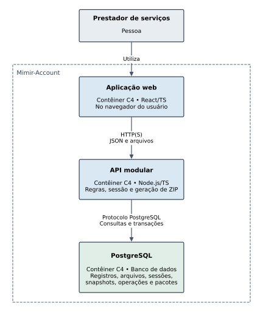

# Mimir-Account

Prova de conceito de uma aplicação web para organização financeira e documental mensal e geração de pacotes de entrega auditáveis para contabilidade externa.

A versão congelada para avaliação experimental é a tag [`poc-v1.0.0`](https://github.com/nickrfer/mimir-account-starter/tree/poc-v1.0.0) (incrementos I01 a I16). O protocolo e os registros da avaliação formal dos requisitos não funcionais (cenários C01 a C06) estão disponíveis em [`docs/avaliacao/`](docs/avaliacao/resultados/README.md).



---

## Visão geral

O Mimir-Account separa o acervo financeiro mutável do mês e os pacotes de entrega já fechados para o contador. Enquanto o usuário registra movimentações, importa extratos CSV, anexa comprovantes, vincula reembolsos entre contas de pessoa física (PF) e jurídica (PJ) e resolve pendências, o espaço de trabalho avança por revisões inteiras (`revision`) sob controle de concorrência otimista (`expectedRevision`).

Quando uma competência é capturada para entrega, o sistema grava em transação única um snapshot completo e imutável (`mimir.snapshot.v1`) do estado daquele mês, sem bloquear nem ser afetado por edições posteriores no acervo vivo. Um executor interno em segundo plano (`DeliveryExecutor`) consome a fila de operações com controle de posse por lease e `fencing_token` monotônico, monta um pacote ZIP estático e autossuficiente (`resumo.html`, `movimentacoes.csv`, `manifesto.json` no esquema `mimir.manifest.v2` e pasta `anexos/`) exclusivamente a partir do snapshot congelado e publica o resultado no banco.

Fora da aplicação, o pacote extraído pode ser validado offline pelo CLI independente (`@mimir/verifier`) contra um manifesto de referência confiável, conferindo hashes SHA-256, tamanhos, integridade referencial e todas as totalizações financeiras.

### Principais capacidades implementadas (I01-I16)

- **Autenticação e isolamento por espaço (I02):** senhas com Argon2id, sessões opacas de 8 h armazenadas como SHA-256, cookies `HttpOnly`/`SameSite=Lax`, validação de `Origin` e proteção CSRF. Todas as chaves estrangeiras e consultas incluem `workspace_id`.
- **Contas PF/PJ e controle de revisão (I03):** cadastro de contas com normalização Unicode NFC, bloqueio transacional do espaço e incremento atômico de `revision`.
- **Lançamentos, edição e exclusão lógica (I04, I12):** receitas, despesas, transferências e lançamentos a esclarecer em centavos inteiros (`BIGINT`) e datas civis explícitas, com geração e reconciliação automática de pendências no mesmo commit.
- **Importação de CSV (I16):** prévia e confirmação atômica de lotes CSV (`mimir.csv-import.v1`) com procedência imutável e detecção determinística de duplicatas e conflitos por fingerprint.
- **Documentos comprobatórios (I05, I15):** upload multipart (`PDF`, `PNG`, `JPEG` até 5 MiB), validação de assinatura binária, armazenamento imutável com SHA-256 calculado no servidor, download, vínculo, substituição e desvínculo.
- **Reembolsos PF -> PJ (I11):** vínculo integral entre despesa empresarial paga em conta PF e saída de reembolso na conta PJ (inclusive entre competências distintas), trazendo automaticamente os lançamentos de contexto de um salto para a prévia e para o pacote.
- **Ciclo de pendências (I13):** abertura de dúvidas manuais, justificativa, resolução e reabertura rastreadas por revisão.
- **Prévia mensal consistente (I06):** leitura em transação `REPEATABLE READ READ ONLY` com fluxo de caixa por conta, totais por categoria (`categoryTotals`), resumo empresarial PF/PJ, vínculos e pendências.
- **Captura idempotente, executor e publicação (I07, I08, I14):** captura com `Idempotency-Key` verificada antes de `expectedRevision`, versões sequenciais por competência (`v1`, `v2` com motivo de retificação), `DeliveryExecutor` (polling de 2 s, lease de 30 s, renovação a cada 5 s, até 3 tentativas) e `resumo.html` formatado para leitura offline pelo contador.
- **Verificador CLI offline (I09) e interface web (I10):** SPA React 19 + TypeScript servida pela API sob `Content-Security-Policy: default-src 'self'` e pacote CLI `@mimir/verifier` sem acesso à rede.

---

## Estrutura do repositório

```text
.
├── apps/
│   ├── api/                 # API HTTP modular (Node.js + TypeScript) e DeliveryExecutor
│   └── web/                 # Interface web SPA (React 19 + TypeScript + Vite)
├── packages/
│   ├── contracts/           # Contratos OpenAPI 3.1, JSON Schemas (manifesto v2, CSV v1) e vetores
│   └── verifier/            # Verificador CLI independente offline (@mimir/verifier)
├── database/
│   └── migrations/          # Migrações SQL (001 a 011) e separação de papéis (migrator vs runtime)
├── docs/
│   ├── adr/                 # Decisões arquiteturais (ADR 001 a ADR 007)
│   ├── avaliacao/           # Protocolo e resultados da avaliação formal C01-C06
│   └── diagrams/            # Diagramas C4 (contexto, contêineres e componentes)
├── fixtures/                # Pacotes sintéticos de referência (outubro_v1, novembro_v1, outubro_v2)
├── tests/                   # Testes unitários e de integração (PostgreSQL e HTTP reais)
└── tools/                   # Scripts de setup, administração, execução Docker e avaliação C01-C06
```

---

## Como executar (Docker e Compose)

O fluxo principal utiliza apenas Docker Engine e Docker Compose (v2.24.4 ou superior), sem exigir Node.js ou `pnpm` instalados na máquina host. As imagens fixam Node.js 24.22.1, `pnpm` 12.16.1 e PostgreSQL 18.6.

### 1. Preparação inicial e subida dos serviços

Em Linux, exporte antes do primeiro setup o UID/GID do usuário atual para que os arquivos de configuração gerados no checkout mantenham as permissões corretas:

```sh
export LOCAL_UID="$(id -u)" LOCAL_GID="$(id -g)"
```

Na raiz do repositório (PowerShell no Windows ou shell POSIX no Linux):

```sh
docker compose -p mimir-setup -f compose.setup.yaml run --rm setup
docker compose up -d --wait db
docker compose run --build --rm admin migrate
docker compose up -d --build api
```

> **Nota:** O comando `setup` gera localmente `.env`, `.env.runtime`, `.env.admin` e `.local/postgres-password` com segredos aleatórios e recusa sobrescrever configuração já existente. Nunca regenere segredos para um volume de banco já inicializado.

Com os serviços ativos, acesse `http://127.0.0.1:3000`.
- `GET /health` retorna `200` quando o processo da API está ativo.
- `GET /ready` retorna `200` quando o banco e o esquema estão acessíveis (`503` caso contrário).

### 2. Provisionamento de proprietário

O cadastro inicial de usuário e espaço de trabalho é feito pela tarefa administrativa `create-owner`, recebendo o payload JSON via `stdin` (sem expor senha em argumentos de linha de comando). Veja os exemplos para PowerShell e shell Linux em [`docs/authentication.md`](docs/authentication.md).

### 3. Desenvolvimento frontend com Vite (opcional)

Para subir o servidor de desenvolvimento Vite em `http://127.0.0.1:5173` com proxy para a API:

```sh
docker compose --profile dev up -d --build dev-web
docker compose --profile dev logs --tail 100 -f dev-web
```

### 4. Logs e encerramento

```sh
docker compose logs --tail 100 -f api db
docker compose ps
docker compose down
```

O comando `down` preserva os volumes de dados (`pgdata`). Não utilize `down -v` se desejar manter os dados persistidos.

---

## Testes e verificador CLI

### Suíte completa em contêiner (unitários, integração PostgreSQL e sondas E2E)

No Windows (PowerShell):

```powershell
& .\tools\test-docker.ps1
```

No Linux / POSIX `sh`:

```sh
sh tools/test-docker.sh
```

Cada execução cria um projeto e um volume Docker isolados (`mimir-docker-*`), aplica as migrações duas vezes (validando idempotência), executa todos os testes unitários e de integração contra o PostgreSQL 18 real, audita o ambiente do processo da API (garantindo ausência de credenciais administrativas), testa indisponibilidade e recriação dos contêineres com preservação de sessão e anexos, valida o proxy/HMR do Vite e executa o verificador offline sobre um pacote real publicado pelo executor.

Para rodar apenas os testes unitários (sem iniciar banco de dados):

```sh
docker compose run --build --rm --no-deps --entrypoint node admin tools/checks/tests.mjs unit
```

### Verificador CLI independente (`@mimir/verifier`)

Para validar um pacote extraído contra um manifesto externo confiável em um contêiner isolado (`network_mode: none`, `read_only: true`):

```sh
docker compose run --build --rm --no-deps \
  -v /caminho/pacote-extraido:/pkg:ro \
  -v /caminho/referencia.manifesto.json:/ref.json:ro \
  verifier /pkg /ref.json
```

Códigos de saída do verificador:
- `0`: pacote íntegro e consistente com o manifesto de referência.
- `1`: violação física, estrutural, relacional ou contábil detectada.
- `2`: erro de uso nos argumentos ou tentativa de autorreferência ao `manifesto.json` interno do próprio pacote.

---

## Avaliação experimental (C01-C06)

Os seis cenários de avaliação dos requisitos não funcionais foram executados sobre a tag [`poc-v1.0.0`](https://github.com/nickrfer/mimir-account-starter/tree/poc-v1.0.0). O protocolo detalhado está em [`docs/avaliacao/protocolo-c01-c06.md`](docs/avaliacao/protocolo-c01-c06.md) e os relatórios completos (JSON e Markdown) em [`docs/avaliacao/resultados/`](docs/avaliacao/resultados/README.md).

| Cenário | Requisito | Resultado observado | Veredito |
| :--- | :--- | :--- | :--- |
| **[C01](docs/avaliacao/resultados/C01.md)** | RNF-01 - Consistência da captura | 100/100 intercalações corretas; 0 misturas de revisão; entrega `v1` preservada byte a byte em 100/100 | Atende com desvio declarado |
| **[C02](docs/avaliacao/resultados/C02.md)** | RNF-02 - Recuperação | 30/30 operações recuperadas em `PRONTA`; 0 `FALHA` terminal; maior tempo após restauração: 28,3 s (meta <= 120 s) | Atende com desvio declarado |
| **[C03](docs/avaliacao/resultados/C03.md)** | RNF-03 - Segurança e isolamento | 36/36 casos negativos bloqueados sem vazamento nem mutação entre espaços; 12/12 sessões revogadas recusadas; 12/12 controles aceitos | Atende com desvio declarado |
| **[C04](docs/avaliacao/resultados/C04.md)** | RNF-04 - Integridade offline | 20/20 adulterações detectadas (5 por classe); controle íntegro aceito; autorreferência recusada | Atende |
| **[C05](docs/avaliacao/resultados/C05.md)** | RNF-05 - Portabilidade offline | 20/20 registros idênticos ao oráculo no Linux (Chromium e LibreOffice) e conferidos no Firefox (Windows) | Atende com desvio declarado |
| **[C06](docs/avaliacao/resultados/C06.md)** | RNF-06 - Desempenho sob carga | 30/30 entregas (200 lançamentos, 50 anexos / 25 MiB) em `PRONTA`; p95 de 2,06 s (meta <= 10 s); pico de RSS de 321,5 MiB (meta <= 512 MiB) | Atende com desvio declarado |

---

## Documentação técnica

| Documento | Conteúdo |
| :--- | :--- |
| [`docs/START_HERE.md`](docs/START_HERE.md) | Visão geral técnica e índice de leitura do projeto |
| [`docs/architecture.md`](docs/architecture.md) | Arquitetura em contêineres, componentes, portas e adaptadores |
| [`docs/domain.md`](docs/domain.md) | Regras de domínio: valores em centavos, datas civis, contas, reembolsos e pendências |
| [`docs/data-model.md`](docs/data-model.md) | Esquema relacional, chaves compostas por espaço, privilégios e fechamento do snapshot |
| [`docs/http-api.md`](docs/http-api.md) | Contratos da API HTTP, autenticação, cabeçalhos de segurança e códigos de erro |
| [`docs/protocols.md`](docs/protocols.md) | Protocolos de revisão otimista, idempotência de captura e lease/fencing do executor |
| [`docs/export-format.md`](docs/export-format.md) | Formato do pacote ZIP estático, `resumo.html`, `movimentacoes.csv` e `manifesto.json` v2 |
| [`docs/category-totals.md`](docs/category-totals.md) | Regras de agregação de `categoryTotals` e separação de lançamentos de contexto |
| [`docs/verifier-acceptance.md`](docs/verifier-acceptance.md) | Critérios de aceite e verificações semânticas do CLI `@mimir/verifier` |
| [`docs/requirements.md`](docs/requirements.md) | Requisitos funcionais (RF-01 a RF-14), não funcionais (RNF-01 a RNF-06) e cenários C01-C06 |
| [`docs/adr/DECISIONS.md`](docs/adr/DECISIONS.md) | Registros de decisão de arquitetura (ADR 001 a ADR 007) |
| [`docs/DEPENDENCIES.md`](docs/DEPENDENCIES.md) | Versões fixadas e inventário de licenças das dependências |
| [`docs/optional-monthly-assistant.md`](docs/optional-monthly-assistant.md) | Proposta arquitetural de extensão futura opcional com IA (não implementada) |

> Artefatos internos de apoio ao desenvolvimento (configuração de ferramentas, especificações internas de incremento e evidências locais de execução E2E) permanecem em repositório privado (`mimir-account-starter-docs`), disponíveis à banca examinadora mediante solicitação.

---

## Licença

Distribuído sob a licença [MIT](LICENSE).
