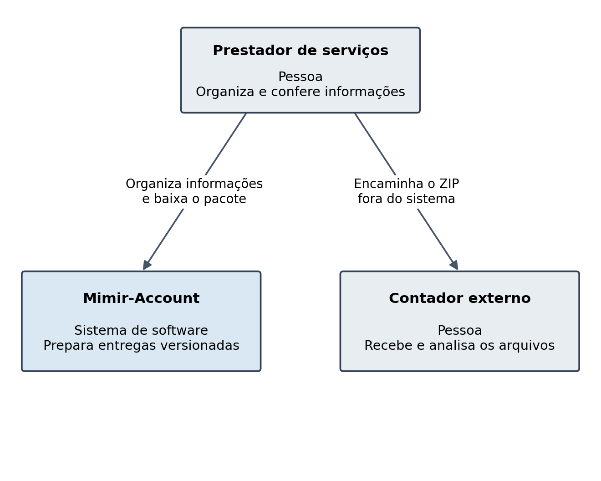
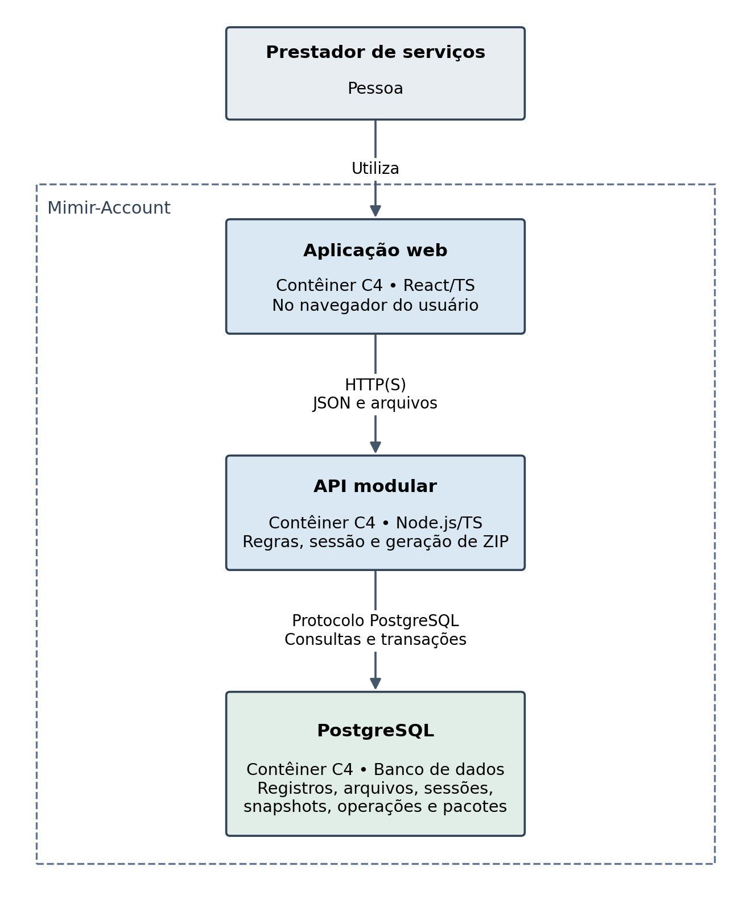
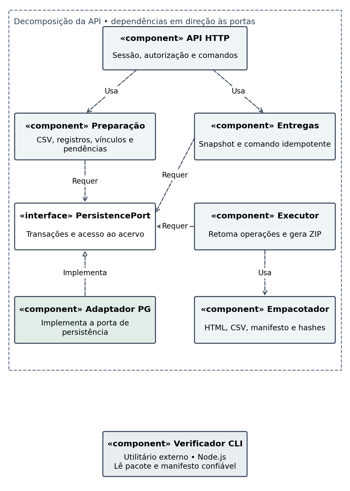

# Arquitetura da PoC

Navegador com React/TS/Vite acessa uma API Node/TS, que concentra as regras e acessa PostgreSQL 18. Na implantação de referência, a API serve os arquivos compilados da SPA. API e PostgreSQL são serviços Compose distintos; o navegador é uma unidade lógica separada. Não são necessários serviços adicionais.

## Responsabilidades

| Elemento | Responsabilidade |
| --- | --- |
| API HTTP | Sessão, CSRF, autorização por objeto, validação, erros e comandos |
| Preparação | Contas, registros, categorias, documentos, CSV, vínculos e pendências |
| Entregas | Captura completa, idempotência, versões, estado e downloads |
| Executor | Adquirir e renovar posse, retomar tentativas, coordenar geração/publicação |
| Empacotador | Produzir HTML/CSV/manifesto/ZIP a partir do snapshot; não conhece SQL |
| Adaptador PG | Implementar PersistencePort com transações e privilégios adequados |
| PersistencePort | Contratos que preservam fronteiras transacionais, não SQL genérico |
| Verificador CLI | Processo independente que lê diretório e referência externa, sem API/banco |

O executor será interno ao processo da API, com coordenação persistida entre Entregas e Executor em incremento posterior. I02 já implementa Argon2id, sessões opacas e contexto autorizado por proprietário; autorização dos futuros comandos financeiros ainda depende de seus incrementos. Versões/licenças efetivas estão em DEPENDENCIES.md e funcionamento da autenticação em authentication.md.

PostgreSQL único simplifica transações entre dados, documentos e pacotes; custa armazenamento, WAL e backups maiores. Processar um trabalho por vez limita vazão. Os limites da PoC tornam essa escolha avaliável; não há garantia de alta disponibilidade ou recuperação da perda do host.

## Diagramas de referência

Os diagramas são desenhos da proposta. Atualizá-los quando o sistema real divergir; não usá-los como prova de código executado.
